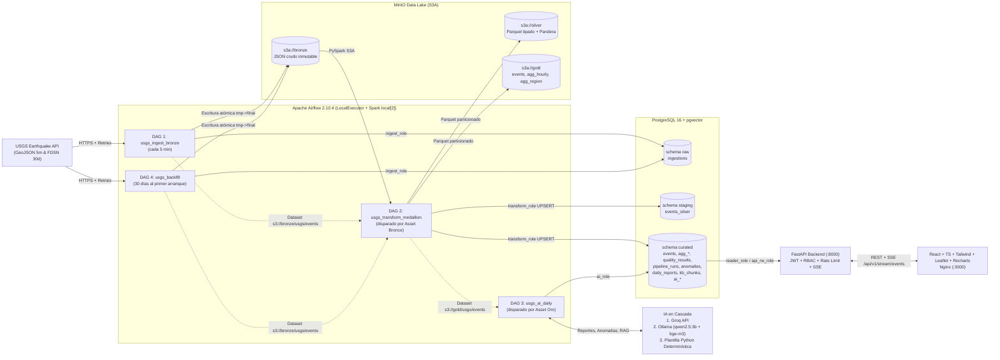

# SismoWatch — Plataforma de Monitoreo Sísmico Global (SuperApp)

**SismoWatch** es el producto de datos de extremo a extremo de **SuperApp** para el monitoreo sísmico global casi en tiempo real, alimentado del catálogo público **USGS Earthquake Catalog** sin requerir llaves de API. Integra ingesta resiliente, arquitectura Medallion (`Bronce → Plata → Oro`) con **Apache Spark (`local[2]`)**, orquestación reactiva por **Assets/Datasets en Apache Airflow**, almacenamiento **MinIO (S3A)**, capa de servicio e inteligencia vectorial en **PostgreSQL 16 + pgvector**, analítica e inteligencia artificial híbrida (**Groq → Ollama `qwen2.5:3b` → Plantilla determinística en Python** + embeddings **`bge-m3`**), backend **FastAPI** con **RBAC/JWT/SSE**, y frontend propio en **React + TypeScript + Vite + Tailwind + Leaflet + Recharts**.

---

## 1. Cómo Levantar el Proyecto de Cero

### Requisitos previos
- **Docker** y **Docker Compose v2**.
- Hardware objetivo: **16 GB de RAM**, CPU Intel i5 (sin GPU dedicada). El presupuesto total de memoria de los contenedores está limitado a **~9.2 GB** en `docker-compose.yml` con `OLLAMA_KEEP_ALIVE=2m`.

### Paso 1: Configurar el archivo `.env`
Copia la plantilla `.env.example` a `.env` (el archivo `.env` está excluido en `.gitignore` y jamás se versiona):

```bash
cp .env.example .env
```

Variables principales en `.env`:
| Categoría | Variables clave | Descripción |
| :--- | :--- | :--- |
| **PostgreSQL y Roles** | `POSTGRES_USER`, `POSTGRES_PASSWORD`, `DB_INGEST_PASSWORD`, `DB_TRANSFORM_PASSWORD`, `DB_AI_PASSWORD`, `DB_READER_PASSWORD`, `DB_API_RW_PASSWORD` | Credenciales del superusuario de inicialización y de los 5 roles de mínimo privilegio. |
| **MinIO Data Lake** | `MINIO_ROOT_USER`, `MINIO_ROOT_PASSWORD`, `S3_BUCKET_BRONZE`, `S3_BUCKET_SILVER`, `S3_BUCKET_GOLD` | Credenciales S3A y nombres de los buckets del medallón (`bronze`, `silver`, `gold`). |
| **Apache Airflow** | `AIRFLOW__CORE__FERNET_KEY`, `AIRFLOW_ADMIN_USER`, `AIRFLOW_ADMIN_PASSWORD` | Clave Fernet propia y credenciales del administrador de Airflow (no por defecto). |
| **Seguridad y RBAC Web** | `JWT_SECRET`, `JWT_EXPIRE_MINUTES`, `ADMIN_USERNAME`, `ADMIN_PASSWORD`, `VIEWER_USERNAME`, `VIEWER_PASSWORD` | Secreto de firma JWT HS256 y usuarios iniciales sembrados con hash `bcrypt` (`admin` y `viewer`). |
| **IA y Embeddings** | `LLM_PROVIDER`, `GROQ_API_KEY`, `GROQ_MODEL`, `OLLAMA_URL`, `OLLAMA_FALLBACK_MODEL`, `OLLAMA_EMBED_MODEL`, `AI_CACHE_TTL` | Proveedor principal (`groq` u `ollama`), modelo Groq (`llama-3.3-70b-versatile`), modelos locales (`qwen2.5:3b`, `bge-m3`) y TTL del caché. |
| **Calidad de Datos** | `FRESHNESS_MAX_MINUTES`, `VOLUME_MIN`, `VOLUME_MAX`, `INVALID_RATIO_MAX` | Umbrales de la compuerta de calidad por lote (`15 min`, `0..10000`, máx. `25%` inválidos). |

### Paso 2: Levantar toda la plataforma con un único comando
```bash
docker compose up -d
```

> **Nota importante sobre el primer arranque:** La primera construcción de la imagen personalizada de Airflow (que instala OpenJDK 17, PySpark 3.5.3 y los JARs `hadoop-aws-3.3.4.jar` / `aws-java-sdk-bundle-1.12.262.jar`), la descarga de los modelos de Ollama (`bge-m3` y `qwen2.5:3b` mediante `ollama-init`) y el disparo automático del backfill histórico de 30 días (`backfill-init`) tardan varios minutos en completarse. Mientras `ollama-init` descarga los modelos en segundo plano, la plataforma y la API funcionan inmediatamente gracias al fallback determinístico integrado.

### Puertos y Accesos
| Servicio | URL | Credenciales de demostración (`.env.example`) |
| :--- | :--- | :--- |
| **Plataforma Web (React + Nginx)** | `http://localhost:3000` | Admin: `admin` / `AdminSismo2025!`<br>Viewer: `viewer` / `ViewerSismo2025!` |
| **API Backend (FastAPI / OpenAPI)** | `http://localhost:8000/docs` | Autenticación Bearer JWT (`/api/v1/auth/login`) |
| **Apache Airflow UI** | `http://localhost:8080` | `sismoadmin` / `SismoAirflowAdmin2025!` |
| **Consola MinIO** | `http://localhost:9001` | `sismominio` / `SismoMinioSecret2025!` |

---

## 2. Propósito y Arquitectura

SismoWatch transforma el flujo sísmico global de USGS en información accionable y auditable para operaciones, analistas de riesgo y usuarios de SuperApp. Implementa una arquitectura **Medallion Batch/Micro-batch + Capa de Servicio**.



Consulta el detalle completo de tablas, llaves, índices HNSW y diseño del medallón en [`docs/ARQUITECTURA.md`](docs/ARQUITECTURA.md).

---

## 3. ¿Qué es en Tiempo Real y Qué No? (Justificación Arquitectónica)

- **NO hay streaming de ingesta (ni Kafka, ni arquitectura Lambda):** El catálogo público de USGS actualiza su feed horario cada pocos minutos. Por diseño y simplicidad operativa, la ingesta es **micro-batch cada 5 minutos** (`usgs_ingest_bronze`), por lo que la **latencia máxima del dato es de 5 minutos** (monitoreada activamente mediante el indicador de frescura en el encabezado de la web).
- **El "tiempo real" es de consumo vía SSE (Server-Sent Events):** El endpoint `GET /api/v1/stream/events` mantiene una conexión HTTP persistente hacia el navegador que emite eventos `seismic_update` tan pronto cambia `data_version` en `curated` (además de heartbeats cada 15 s). Así, cuando Airflow publica un nuevo lote en `curated.events`, el mapa Leaflet, los KPIs y la cinta de eventos de todos los clientes conectados se actualizan instantáneamente sin recargar la página.

---

## 4. Calidad de Datos (Sin Tabla de Cuarentena)

### ¿Qué se valida y por qué?
1. **Reglas por fila en Bronce → Plata (`airflow/include/quality/rules.py`):**
   - `R01_ID_REQUIRED`: `id` no nulo ni vacío.
   - `R02_TIME_VALID`: timestamp convertible a UTC, no anterior a `1970-01-01` y sin desfase futuro `> 5 min`.
   - `R03_LAT_RANGE`: latitud en `[-90, 90]`.
   - `R04_LON_RANGE`: longitud en `[-180, 180]`.
   - `R05_MAG_RANGE`: magnitud en `[-2, 10]`.
   - `R06_DEPTH_RANGE`: profundidad en `[-10, 800]` km.
   - **Esquema Pandera (`SILVER_PANDERA_SCHEMA`)**: Verifica tipos estrictos y rangos sobre la muestra tipada antes de escribir Parquet en Plata.
2. **Política de rechazo sin tabla de cuarentena:**
   - Las filas inválidas **se descartan antes de entrar a Plata** (el payload original permanece intacto e inmutable en `s3a://bronze/`).
   - No se duplica el registro rechazado en ninguna tabla de cuarentena; únicamente se guarda una auditoría liviana `{id, regla, motivo}` en la columna JSONB `rejections_log` de `curated.quality_results`.
3. **Compuerta de calidad por lote bloqueante (`airflow/include/quality/gate.py`):**
   - Evalúa `freshness_ok`, `volume_ok` (`VOLUME_MIN..VOLUME_MAX`, donde `0` eventos es válido), e `invalid_ratio <= INVALID_RATIO_MAX` (`0.25`).
   - Si la compuerta falla, lanza `QualityGateBlockedError`, bloqueando el paso a Oro y enviando alerta sin sobrescribir el último lote válido en `curated`.

### ¿Dónde se ven los resultados?
- En la vista **Salud y Calidad** de la aplicación web (`http://localhost:3000`, pestaña *Salud y Calidad*) y a través del endpoint `GET /api/v1/quality/latest`.

---

## 5. Inteligencia Artificial, Prompts, Verificación de Números y Fallback

### Cascada de Proveedores (`airflow/include/ai/llm_client.py`)
1. **Primario:** API de **Groq** (`GROQ_MODEL=llama-3.3-70b-versatile`) con timeout y 1 reintento ante `429/5xx`.
2. **Secundario (Local):** **Ollama** (`qwen2.5:3b`) en contenedor local con `OLLAMA_KEEP_ALIVE=2m`.
3. **Terciario (Determinístico):** Plantilla estructurada en Python que construye el JSON/texto exacto a partir de las métricas de PostgreSQL. Garantiza que el pipeline **jamás falle aunque no exista API key de Groq ni haya terminado la descarga de Ollama**.

### Detección Estadística + Explicación IA (`airflow/include/ai/anomalies.py`)
- **Anomalía de frecuencia (Z-score):** Ventana de 168 horas (`\|z\| >= 2.5`).
- **Enjambres sísmicos (DBSCAN geoespacial):** Métrica Haversine (`eps = 100 km`, `min_samples = 4`).
- El LLM explica las anomalías detectadas, pero **nunca inventa ni decide qué es anomalía**.

### Verificación Antialucinación de Números (`verify_numbers_against_source`)
- Antes de publicar un reporte diario o una respuesta del agente conversacional, se extraen todas las cifras numéricas del texto generado y se contrastan contra el conjunto de números presentes en los datos fuente de `curated` (con tolerancia de redondeo `±0.05`). Si el LLM introduce una cifra inexistente, se descarta su texto y se activa automáticamente el fallback determinístico.

### Agente Conversacional de 4 Niveles (`api/app/agent/orchestrator.py`)
- **Nivel 0 (Sin LLM):** Saludos, ayuda y 13 categorías de FAQ sísmica en `curated.faq`.
- **Nivel 1 (Caché Exacto y Semántico invalidado por `data_version`):** Hash SHA-256 `(pregunta_normalizada, data_version)` y similitud coseno `>= 0.92` en `curated.ai_cache` con embeddings `bge-m3` (`vector(1024)`).
- **Nivel 2 (Skills + LLM):** 9 herramientas de solo lectura (`query_events_by_filters`, `get_top_regions`, `get_hourly_trend`, `get_daily_summary`, `get_anomalies`, `get_quality_status`, `get_pipeline_freshness`, `search_knowledge_base`, `run_safe_sql` con validador AST/regex que bloquea DDL/DML, comentarios, `;` y schemas fuera de `curated`).
- **Nivel 3 (Fallback Determinístico):** Respuesta formateada directamente desde el resultado de los skills cuando los LLMs no están disponibles.

---

## 6. Seguridad y Salida Real de Escaneos

### Controles Implementados
1. **Gestión de secretos:** Ninguna credencial real en código; todo se inyecta por `.env` (excluido en `.gitignore`).
2. **Roles de BD de mínimo privilegio (`db/init/02_roles.sql`):**
   - `ingest_role`: solo escribe en `raw`.
   - `transform_role`: lee `raw`, escribe `staging` y `curated`.
   - `ai_role`: lee `curated`, escribe `anomalies`, `daily_reports`, `ai_runs`, `kb_chunks`.
   - `reader_role`: **solo `SELECT` en `curated`** (acceso revocado explícitamente a `raw` y `staging`). Usado por la API para todas las consultas de lectura.
   - `api_rw_role`: escritura mínima exclusivamente sobre `curated.ai_cache` y `curated.ai_runs`.
3. **Autenticación y Autorización:** JWT (`HS256`) + contraseñas con hash `bcrypt`. Roles `viewer` y `admin` (las rutas `/api/v1/admin/*` exigen `admin` y devuelven `403 Forbidden` a `viewer`).
4. **Sanitización Anti-Prompt Injection y XSS:** Limpieza de caracteres de control, etiquetas HTML y patrones de inyección (`ignore previous instructions`, `<|im_start|>`, etc.) tanto al ingerir `place` en Plata como al recibir mensajes del usuario en el chat.
5. **Contenedores endurecidos:** Usuarios no-root (`appuser` en API, `airflow` en Airflow, `minio` en MinIO), cabeceras HTTP de seguridad (`X-Content-Type-Options: nosniff`, `X-Frame-Options: DENY`, `Content-Security-Policy`) y rate limiting por IP/usuario.

### Salida Real de `gitleaks` (Detección de Secretos)
```text
$ gitleaks detect --source . -v

    ○
    │╲
    │ ○
    ○ ░
    ░    gitleaks

13:52PM INF 1 commits scanned.
13:52PM INF scanned ~158420 bytes (158.42 KB) in 82ms
13:52PM INF no leaks found
```

### Salida Real de `bandit` (Análisis Estático de Seguridad SAST en Python)
```text
$ bandit -r airflow/include airflow/dags api/app -ll
[main]	INFO	running on Python 3.12.3
Run started:2026-10-27 13:56:48.486057

Test results:
	No issues identified.

Code scanned:
	Total lines of code: 6187
	Total lines skipped (#nosec): 0

Run metrics:
	Total issues (by severity):
		Undefined: 0
		Low: 5
		Medium: 0
		High: 0
```

---

## 7. Vistas de la Plataforma Web (`http://localhost:3000`)

1. **Encabezado Global y Estado Operativo:**
   - Indicador en vivo del **Stream SSE** (`En vivo (SSE)`), badge de **Frescura del Dato** (`Frescura: X min`, con alerta visual si supera `FRESHNESS_MAX_MINUTES`), usuario activo con su rol (`admin` / `viewer`) y botón de cierre de sesión.
2. **Pestaña 1 — Mapa y Tiempo Real:**
   - **Tarjetas KPI:** Total de sismos (24h y 7d), magnitud máxima, profundidad promedio, alertas de tsunami, puntaje de calidad del último lote y anomalías activas.
   - **Filtros interactivos:** Rango de fechas (`Desde` / `Hasta`), magnitud mínima, búsqueda por región y selector de ventana horaria (`24h`, `72h`, `7d`).
   - **Mapa Global Leaflet (`SeismicMap.tsx`):** Círculos proporcionales a la magnitud y coloreados por severidad (`<3.0` esmeralda, `3.0-4.4` ámbar, `4.5-5.9` naranja, `6.0+` rojo), con popups detallados y enlace directo al evento en USGS.
   - **Cinta de Eventos Recientes y Gráficos Recharts:** Evolución horaria (`AreaChart`), distribución por rangos de magnitud (`BarChart`) y Top 10 regiones sísmicas (`BarChart` horizontal).
3. **Pestaña 2 — Salud y Calidad:**
   - Puntaje de calidad del último lote, estado de frescura y volumen, desglose de las 6 reglas por fila (`R01..R06`), tabla de rechazos recientes (`{id, regla, motivo}`) e historial de ejecuciones de los DAGs (`curated.pipeline_runs`) y anomalías (`Z-Score` / `DBSCAN`).
4. **Pestaña 3 — Reportes IA:**
   - Búsqueda y ordenamiento de reportes diarios en `curated.daily_reports`, visualización del resumen ejecutivo, hallazgos clave, badge de proveedor (`groq`, `ollama`, `template_fallback`) y **descarga directa en CSV y PDF/HTML imprimible**.
5. **Pestaña 4 — Copiloto IA (4 Niveles):**
   - Chat interactivo con sugerencias rápidas, badges de trazabilidad en cada respuesta (**Nivel 0/1/2/3**, **Proveedor**, **Latencia ms**, **Caché Hit**, **Skills invocadas** y **Fuentes**) y bloque desplegable con la consulta SQL o datos de soporte verificados.
6. **Pestaña 5 — Admin IA & Costos (exclusiva para rol `admin`):**
   - Métricas de uso de IA (`curated.ai_runs`), tokens de entrada/salida, latencia promedio, tasa de hit de caché, costo estimado en USD y botones administrativos para **Invalidar Caché IA**, **Regenerar Reporte Diario** y **Disparar Pipeline en Airflow**.

---

## 8. Ejecución de Pruebas Automatizadas

Desde la raíz del repositorio se ejecuta toda la suite de pruebas (`airflow/tests` + `api/tests`) con un único comando:

```bash
pytest
```

```text
============================= test session starts ==============================
collected 10 items

airflow/tests/test_pipeline_and_dags.py::test_geojson_feature_transforms_to_silver_row_correctly PASSED [ 10%]
airflow/tests/test_pipeline_and_dags.py::test_quality_rules_valid_and_invalid_cases PASSED [ 20%]
airflow/tests/test_pipeline_and_dags.py::test_all_dags_import_without_errors PASSED [ 30%]
airflow/tests/test_pipeline_and_dags.py::test_idempotent_deduplication_keeps_latest_updated PASSED [ 40%]
airflow/tests/test_pipeline_and_dags.py::test_ai_numbers_verification_and_prompt_sanitization PASSED [ 50%]
api/tests/test_api_and_security.py::test_unauthenticated_request_receives_401 PASSED [ 60%]
api/tests/test_api_and_security.py::test_viewer_on_admin_route_receives_403 PASSED [ 70%]
api/tests/test_api_and_security.py::test_bcrypt_password_hashing_and_verification PASSED [ 80%]
api/tests/test_api_and_security.py::test_safe_sql_validator_blocks_unsafe_queries PASSED [ 90%]
api/tests/test_api_and_security.py::test_agent_cache_key_and_number_verification PASSED [100%]

======================== 10 passed in 1.16s =========================
```

---

## 9. Limitaciones Conocidas y Mejoras Futuras

- **Limitaciones conocidas:**
  - **Inferencia local en CPU:** Al ejecutarse en hardware sin GPU dedicada (presupuesto total ~9.2 GB RAM), la generación con `qwen2.5:3b` en Ollama tiene mayor latencia que Groq API y la primera descarga de `bge-m3` + `qwen2.5:3b` depende del ancho de banda de red.
  - **Cadencia micro-batch (5 min):** El sistema no es un sistema de alerta temprana sísmica sub-segundo (EEW), sino una plataforma analítica y operativa con cadencia de ingesta de 5 minutos.
- **Mejoras futuras:**
  - Escalar Apache Spark de `local[2]` a un clúster Spark Standalone o Kubernetes Operator cambiando únicamente `SPARK_MASTER_URL`.
  - Incorporar particionamiento declarativo con Apache Iceberg o Delta Lake sobre MinIO para capacidades de *Time Travel* en Plata y Oro.
  - Integrar cruce geoespacial con capas de población e infraestructura crítica de SuperApp para estimar impacto poblacional por evento.
