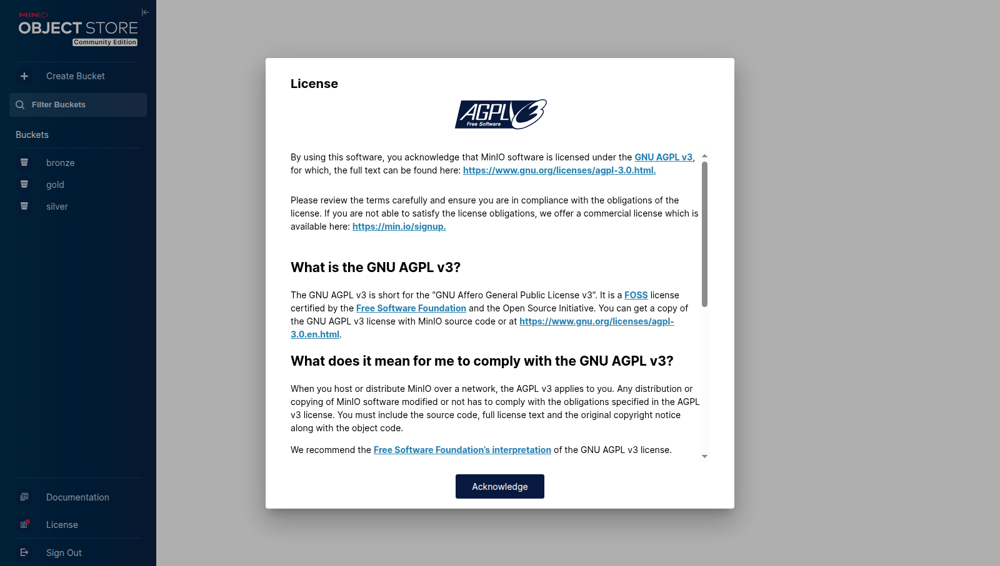
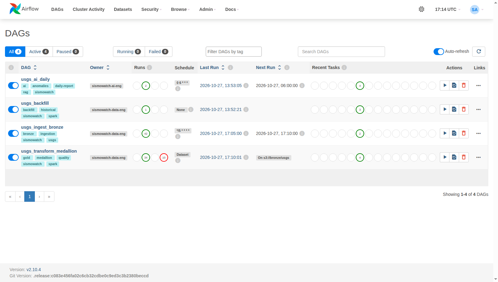
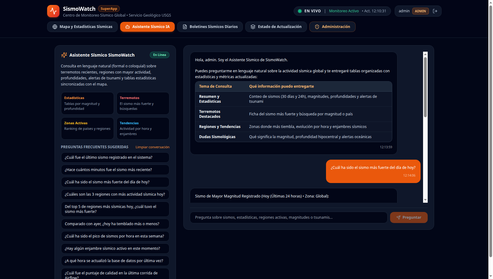
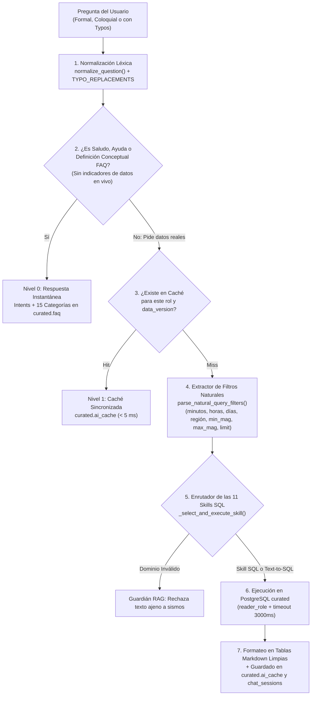
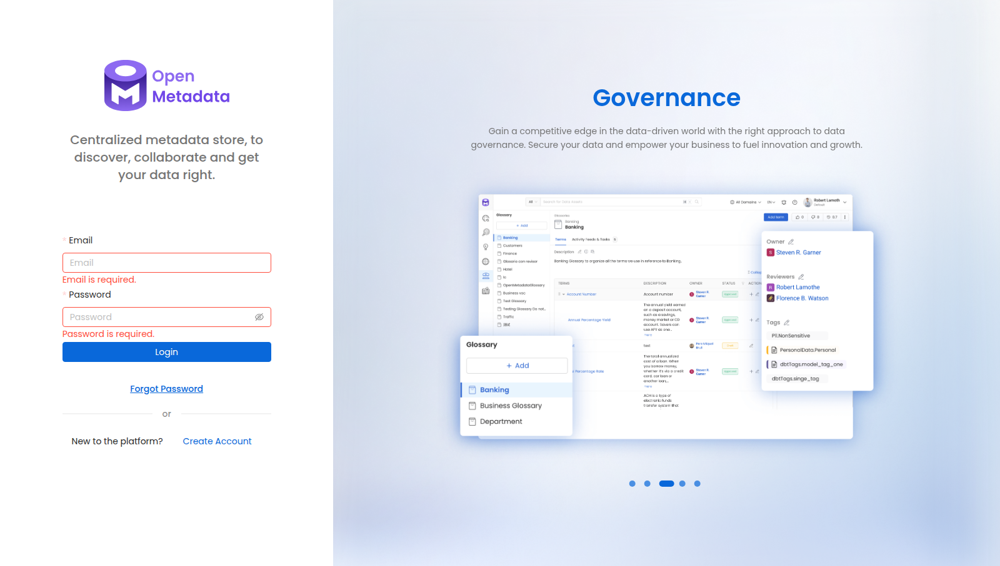
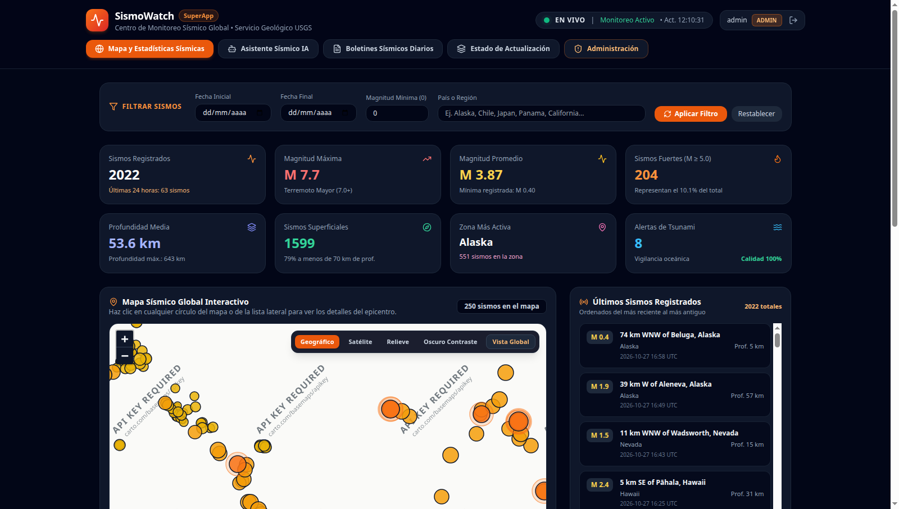

# SismoWatch — Plataforma de Monitoreo, Ingeniería Medallion (Spark + Airflow), Inteligencia Artificial y Gobernanza Sísmica (SuperApp)

**SismoWatch** es el producto de datos e inteligencia artificial de extremo a extremo de **SuperApp** para el monitoreo sísmico global casi en tiempo real, alimentado del catálogo público **USGS Earthquake Catalog** sin requerir llaves externas de API.

Combina **Arquitectura Medallion (`Bronce → Plata → Oro`)**, procesamiento distribuido en **Apache Spark (`PySpark 3.5.3` en modo `local[2]`)**, orquestación reactiva orientada a datos con **Apache Airflow `2.10.4` (Datasets/Assets)**, compuerta bloqueante de calidad **Pandera**, un **ecosistema dual de Inteligencia Artificial** (automatizaciones batch en Airflow + agente analítico en vivo **`SismoWatch AI`** en FastAPI con **11 skills**, **Text-to-SQL seguro**, **RAG `pgvector` HNSW** y **caché semántica/exacta invalidada por `data_version`**), y **Gobernanza + Linaje Visual** con **OpenMetadata `1.5.11`**.

---

## Tabla de Contenidos

1. [Estado de Docker, Guía de Despliegue y Accesos](#1-estado-de-docker-guía-de-despliegue-y-accesos)
2. [Arquitectura General y Flujo Actualizado de Extremo a Extremo](#2-arquitectura-general-y-flujo-actualizado-de-extremo-a-extremo)
3. [Arquitectura Medallion y Motor de Procesamiento en Apache Spark](#3-arquitectura-medallion-y-motor-de-procesamiento-en-apache-spark)
   - [3.1 Clarificación Técnica: ¿Apache Spark o Pandas?](#31-clarificación-técnica-apache-spark-o-pandas)
   - [3.2 Almacenamiento en Data Lake MinIO (S3A)](#32-almacenamiento-en-data-lake-minio-s3a)
   - [3.3 Configuración y Escalabilidad de Apache Spark](#33-configuración-y-escalabilidad-de-apache-spark-sessionpy)
   - [3.4 El Recorrido del Dato por las 3 Capas Medallion](#34-el-recorrido-del-dato-por-las-3-capas-medallion)
4. [Orquestación Reactiva en Apache Airflow: Los 4 DAGs y Datasets](#4-orquestación-reactiva-en-apache-airflow-los-4-dags-y-datasets)
5. [Arquitectura Profunda de Inteligencia Artificial (`SismoWatch AI`)](#5-arquitectura-profunda-de-inteligencia-artificial-sismowatch-ai)
   - [5.1 Estructura de Carpetas y Módulos de IA](#51-estructura-de-carpetas-y-módulos-de-ia)
   - [5.2 Modelos de IA, Cascada de Proveedores y Gestión de Memoria](#52-modelos-de-ia-cascada-de-proveedores-y-gestión-de-memoria)
   - [5.3 Arquitectura de Caché Exacta, Semántica e Invalidación por `data_version`](#53-arquitectura-de-caché-exacta-semántica-e-invalidación-por-data_version)
   - [5.4 Indexación Vectorial RAG (`bge-m3` 1024-d + HNSW) y Guardián de Dominio](#54-indexación-vectorial-rag-bge-m3-1024-d--hnsw-y-guardián-de-dominio)
   - [5.5 IA Batch en Airflow: Anomalías (`Z-score` + `DBSCAN`) y Boletines Verificados](#55-ia-batch-en-airflow-anomalías-z-score--dbscan-y-boletines-verificados)
   - [5.6 Agente Analítico en Tiempo Real: System Prompt, 11 Skills y Text-to-SQL](#56-agente-analítico-en-tiempo-real-system-prompt-11-skills-y-text-to-sql)
   - [5.7 Banco Oficial de 35 Consultas Preparadas en Tiempo Real](#57-banco-oficial-de-35-consultas-preparadas-en-tiempo-real)
6. [Calidad de Datos (`Pandera`) y Gobernanza Visual (`OpenMetadata`)](#6-calidad-de-datos-pandera-y-gobernanza-visual-openmetadata)
7. [Seguridad, Roles RBAC y Auditorías (`gitleaks` / `bandit`)](#7-seguridad-roles-rbac-y-auditorías-gitleaks--bandit)
8. [Vistas del Dashboard Web y Galería Visual del Sistema](#8-vistas-del-dashboard-web-y-galería-visual-del-sistema)
9. [Pruebas Automatizadas y Comandos Operativos](#9-pruebas-automatizadas-y-comandos-operativos)

---

## 1. Estado de Docker, Guía de Despliegue y Accesos

### Levantar el ecosistema completo
```bash
cp .env.example .env
docker compose up -d
```

### Estado real verificado de los contenedores (`docker compose ps`)
Los **9 servicios principales** más los **3 inicializadores one-shot** (`airflow-init`, `backfill-init`, `openmetadata-init`) corren de forma saludable (`healthy`) dentro de la red aislada `sismowatch_internal_net`:

```text
NAME                           IMAGE                                                  STATUS                   PORTS
sismowatch-airflow-scheduler   sismowatch-airflow:2.10.4                              Up (healthy)             8080/tcp
sismowatch-airflow-webserver   sismowatch-airflow:2.10.4                              Up (healthy)             0.0.0.0:8080->8080/tcp
sismowatch-api                 sismowatch-api:1.0.0                                   Up (healthy)             0.0.0.0:8000->8000/tcp
sismowatch-web                 sismowatch-web:1.0.0                                   Up (healthy)             0.0.0.0:3000->8080/tcp
sismowatch-ollama              ollama/ollama:0.3.14                                   Up (healthy)             11434/tcp
sismowatch-minio               alpine/minio:RELEASE.2025-10-15T17-29-55Z              Up (healthy)             0.0.0.0:9001->9001/tcp
sismowatch-postgres            pgvector/pgvector:pg16                                 Up (healthy)             5432/tcp
sismowatch-om-elasticsearch    docker.elastic.co/elasticsearch/elasticsearch:8.11.4   Up (healthy)             9200/tcp
sismowatch-openmetadata        openmetadata/server:1.5.11                             Up (healthy)             0.0.0.0:8585->8585/tcp
```

### Puertos y Credenciales de Acceso

| Servicio | URL | Usuario / Correo | Contraseña | Propósito |
| :--- | :--- | :--- | :--- | :--- |
| **Aplicación Web (`SismoWatch UI`)** | `http://localhost:3000` | `admin`<br>`viewer` | `AdminSismo2026!`<br>`ViewerSismo2026!` | Mapa global, 8 KPIs, 4 gráficas Recharts, Boletines, Chat IA y Admin |
| **API Backend (`FastAPI` + Swagger)** | `http://localhost:8000/docs` | Bearer JWT (`/api/auth/login`) | — | Endpoints REST, Stream SSE (`/api/stream`) y Orquestador IA |
| **Apache Airflow (`2.10.4`)** | `http://localhost:8080` | `sismowatch_admin` | `sw_airflow_admin_9812` | Orquestación de los 4 DAGs, Datasets y jobs de PySpark |
| **Consola MinIO (`S3A`)** | `http://localhost:9001` | `sismowatch_minio` | `sw_minio_local_9812` | Buckets Medallion (`bronze`, `silver`, `gold`) |
| **OpenMetadata (`1.5.11`)** | `http://localhost:8585` | `admin@open-metadata.org` | `admin` | Catálogo de 15 tablas, 3 buckets, 4 DAGs, 14 aristas de linaje y glosario |

---

## 2. Arquitectura General y Flujo Actualizado de Extremo a Extremo

El siguiente diagrama refleja la **arquitectura técnica completa y actualizada** del sistema, detallando cada componente, herramienta, flujo de datos, capa Medallion, proceso distribuido de Spark, compuerta de calidad Pandera, bases de datos, catálogo de gobernanza, orquestación de IA y frontend en tiempo real:

```mermaid
flowchart TB
    subgraph S1["1. FUENTE EXTERNA GEOFÍSICA"]
        USGS_LIVE["USGS Live Feed\n(all_hour.geojson cada 5 min)"]
        USGS_HIST["USGS FDSNWS Query\n(Histórico 30 días en ventanas de 7d)"]
    end

    subgraph S2["2. ORQUESTACIÓN Y EVENT-DRIVEN DATASETS (Apache Airflow 2.10.4)"]
        DAG1["DAG 1: usgs_ingest_bronze\n(Cron: */5 * * * *)"]
        DAG4["DAG 4: usgs_backfill\n(Auto-init 30d / manual)"]
        DS_BRONZE{{"Airflow Dataset\ns3://bronze/usgs/events"}}
        DAG2["DAG 2: usgs_transform_medallion\n(Reactivo al Dataset Bronce)"]
        DS_GOLD{{"Airflow Dataset\ns3://gold/usgs/events"}}
        DAG3["DAG 3: usgs_ai_daily\n(Reactivo al Dataset Oro)"]
    end

    subgraph S3["3. ALMACENAMIENTO LAGO DE DATOS S3A (MinIO Data Lake)"]
        MINIO_BRONZE["🥉 CAPA BRONCE (Cruda e Inmutable)\ns3a://bronze/usgs/events/YYYY/MM/DD/*.json\ns3a://bronze/usgs/backfill/*.json"]
        MINIO_SILVER["🥈 CAPA PLATA (Limpia y Tipada en Parquet)\ns3a://silver/events/event_date=YYYY-MM-DD/*.parquet"]
        MINIO_GOLD["🥇 CAPA ORO (Agregada y Optimizada)\ns3a://gold/events/*.parquet\ns3a://gold/agg_hourly/*.parquet\ns3a://gold/agg_region/*.parquet"]
    end

    subgraph S4["4. MOTOR DE CÓMPUTO DISTRIBUIDO (Apache Spark / PySpark 3.5.3 local[2])"]
        SPARK_B2S["PySpark Job: bronze_to_silver.py\n• Aplanado GeoJSON a PARSED_ROW_SCHEMA\n• Sanitización Prompt Injection (sanitize_place)\n• Evaluación 6 Reglas de Negocio (R01..R06)\n• Deduplicación Window: partitionBy('id').orderBy('updated'.desc)"]
        GATE_PANDERA["Compuerta de Calidad: Pandera (gate.py)\n• Validación estricta SILVER_PANDERA_SCHEMA\n• Presupuesto de error < 25% | Frescura | Volumen"]
        SPARK_S2G["PySpark Job: silver_to_gold.py\n• Agregación agg_hourly (date_trunc hora)\n• Agregación agg_region (cubo regional diario)\n• dynamic partition overwrite mode"]
    end

    subgraph S5["5. BASE DE DATOS TRANSACCIONAL, ANALÍTICA Y VECTORIAL (PostgreSQL 16 + pgvector)"]
        PG_RAW["Schema raw\n• raw.ingestions (auditoría payloads)"]
        PG_STG["Schema staging\n• staging.events_silver (espejo analítico)"]
        PG_CURATED["Schema curated (Capa de Servicio Indexada < 20ms)\n• curated.events (2,000+ sismos deduplicados)\n• curated.agg_hourly & agg_region\n• curated.quality_results & pipeline_runs\n• curated.anomalies & daily_reports\n• curated.kb_chunks (Vectores RAG 1024-d HNSW)\n• curated.ai_cache & chat_sessions"]
    end

    subgraph S6["6. GOBERNANZA, CATÁLOGO Y LINAJE VISUAL (OpenMetadata 1.5.11)"]
        OM_CORE["OpenMetadata Server (:8585)\n• 15 Tablas catalogadas con esquema y descripciones\n• 3 Buckets S3 (bronze, silver, gold)\n• 4 DAGs y Pipelines de Airflow\n• 14 Aristas de Linaje Visual Extremo a Extremo\n• Glosario de Términos Sísmicos"]
    end

    subgraph S7["7. ECOSISTEMA DUAL DE INTELIGENCIA ARTIFICIAL (SismoWatch AI)"]
        AI_BATCH["IA Batch en Airflow (airflow/include/ai/)\n• Anomalías Z-score (72h) + DBSCAN (100km Haversine)\n• Boletín Ejecutivo Diario con Pydantic y Verificador Numérico\n• Vectorización RAG bge-m3 (1024-d) en kb_chunks"]
        AI_ONLINE["Agente Analítico en Vivo (api/app/agent/)\n• Nivel 0: Intents + 15 FAQs conceptuales\n• Nivel 1: Caché Exacta (SHA-256) y Semántica (HNSW) ligada a data_version\n• Nivel 2: Parser de Lenguaje Natural (fechas, magnitudes, regiones)\n• Nivel 3: 11 Skills SQL en Vivo + Text-to-SQL Seguro (validate_safe_sql)\n• Cascada: Groq Llama-3.3-70b → Ollama Qwen2.5:3b → Tablas Determinísticas"]
    end

    subgraph S8["8. CAPA DE SERVICIO Y STREAMING (FastAPI Backend :8000)"]
        FASTAPI["FastAPI Application\n• Autenticación JWT HS256 + RBAC (admin/viewer)\n• Endpoints REST /api/* (latencia < 20ms)\n• Canal Server-Sent Events /api/stream (actualización push reactiva)"]
    end

    subgraph S9["9. INTERFAZ DE USUARIO Y EXPERIENCIA (React 18 + TS + Tailwind :3000)"]
        DASHBOARD["SismoWatch Web UI\n• Mapa Global Interactivo Leaflet (SeismicMap)\n• 8 Tarjetas KPI Sincronizadas en Tiempo Real\n• 4 Gráficas Recharts h-80 (Evolución, Escalas, Regiones, Profundidad)\n• Chat Conversacional SismoWatch AI con Tablas Markdown\n• Centro de Boletines Diarios con Descarga CSV y PDF/HTML"]
    end

    %% Conexiones Flujo Ingesta
    USGS_LIVE -->|GET HTTPS / 5 min| DAG1
    USGS_HIST -->|Query FDSNWS / 7d windows| DAG4
    DAG1 & DAG4 -->|1. Ingesta Atómica .tmp -> final| MINIO_BRONZE
    DAG1 & DAG4 -->|2. Registro de Ingesta| PG_RAW
    DAG1 & DAG4 -->|3. Emite Dataset| DS_BRONZE

    %% Conexiones Transformación Medallion
    DS_BRONZE ==>|4. Dispara DAG reactivamente| DAG2
    MINIO_BRONZE -->|5. Lectura S3A| SPARK_B2S
    SPARK_B2S -->|6. Escritura Parquet Particionado| MINIO_SILVER
    SPARK_B2S -.->|Espejo SQL| PG_STG
    MINIO_SILVER -->|7. Muestra para Validación| GATE_PANDERA
    GATE_PANDERA -->|8. Aprueba Compuerta| SPARK_S2G
    GATE_PANDERA -.->|Rastro de Calidad JSONB| PG_CURATED
    SPARK_S2G -->|9. Escribe Oro Parquet| MINIO_GOLD
    SPARK_S2G -->|10. Batch Upsert ACID| PG_CURATED
    DAG2 -.->|11. Sync Fail-Open REST| OM_CORE
    DAG2 -->|12. Emite Dataset| DS_GOLD

    %% Conexiones IA Batch
    DS_GOLD ==>|13. Dispara DAG reactivamente| DAG3
    DAG3 <-->|14. Z-score + DBSCAN + Reportes + Chunks| PG_CURATED
    DAG3 <-->|15. Inferencia LLM / Embeddings| AI_BATCH

    %% Conexiones Serving e IA en Vivo
    PG_CURATED -->|16. Consultas < 20ms (reader_role)| FASTAPI
    FASTAPI <-->|17. Invocación de Skills y SQL Seguro| AI_ONLINE
    PG_CURATED <-->|18. RAG HNSW + Caché Semántica| AI_ONLINE
    FASTAPI -->|19. REST API + Push SSE por data_version| DASHBOARD
```

---

## 3. Arquitectura Medallion y Motor de Procesamiento en Apache Spark

Toda la ingeniería de datos del proyecto sigue el paradigma **Medallion (`Bronce → Plata → Oro`)**, ejecutado mediante **Apache Spark (`PySpark 3.5.3`)** integrado directamente dentro del contenedor de Airflow con OpenJDK 17 y los conectores `hadoop-aws-3.3.4.jar` y `aws-java-sdk-bundle-1.12.262.jar`.

### 3.1 Clarificación Técnica: ¿Apache Spark o Pandas?

Para disipar cualquier duda sobre la tecnología de procesamiento del sistema:

> [!IMPORTANT]
> **El motor de procesamiento y transformación distribuida en SismoWatch es Apache Spark (`PySpark 3.5.3`).**
> **Pandas NO se utiliza para las transformaciones de datos ni para la arquitectura Medallion.** Su uso en el proyecto está estrictamente delimitado a dos puentes auxiliares en memoria.

| Dimensión Técnica | Apache Spark (`PySpark 3.5.3`) — **Motor Principal** | Pandas (`pandas`) — **Puente Auxiliar Único** |
| :--- | :--- | :--- |
| **Rol en el Sistema** | **Transformación central distribuida Medallion** (`Bronce → Plata → Oro`). | **Compuerta estadística de Pandera y transporte de inserción SQL**. |
| **Archivos de Código** | • [`airflow/include/spark_jobs/session.py`](file:///home/cohorte5/IAriwi/airflow/include/spark_jobs/session.py)<br>• [`airflow/include/spark_jobs/bronze_to_silver.py`](file:///home/cohorte5/IAriwi/airflow/include/spark_jobs/bronze_to_silver.py)<br>• [`airflow/include/spark_jobs/silver_to_gold.py`](file:///home/cohorte5/IAriwi/airflow/include/spark_jobs/silver_to_gold.py) | • [`airflow/include/quality/gate.py`](file:///home/cohorte5/IAriwi/airflow/include/quality/gate.py)<br>• [`airflow/include/publish/postgres_publisher.py`](file:///home/cohorte5/IAriwi/airflow/include/publish/postgres_publisher.py) |
| **Operaciones que realiza** | • Aplanado de GeoJSON jerárquico a columnas tipadas.<br>• Sanitización de inyecciones de texto.<br>• Evaluación de 6 reglas de negocio por fila (`rules.py`).<br>• Deduplicación analítica con funciones ventana (`Window.partitionBy`).<br>• Escritura columnar Parquet particionado en MinIO S3A.<br>• Agregaciones horarias (`agg_hourly`) y territoriales (`agg_region`).<br>• Sobrescritura dinámica de particiones (`partitionOverwriteMode=dynamic`). | • Evaluación de esquema y reglas estadísticas con **`Pandera`** (`SILVER_PANDERA_SCHEMA`).<br>• Lectura del Parquet Oro recién generado para construir la lista de tuplas enviadas a `psycopg2.extras.execute_values` para el `UPSERT` en PostgreSQL. |
| **Escalabilidad** | Distribuido horizontalmente. Funciona en `local[2]` y escala a clústeres Spark Standalone o Kubernetes con solo cambiar `SPARK_MASTER`. | Monohilo en memoria. Limitado al tamaño de un único lote temporal. |

### 3.2 Almacenamiento en Data Lake MinIO (S3A)

Todos los artefactos de datos crudos, particionados y analíticos residen en los buckets de **MinIO (`http://localhost:9001`)**:


*Figura 1: Consola de MinIO Object Storage mostrando los buckets Medallion `bronze`, `silver` y `gold`.*

### 3.3 Configuración y Escalabilidad de Apache Spark ([`session.py`](file:///home/cohorte5/IAriwi/airflow/include/spark_jobs/session.py))
- **Ejecución ligera `local[2]`:** Para operar con holgura dentro de un servidor de 16 GB de RAM sin GPU dedicada, `create_spark_session()` configura `spark.driver.memory=768m`, `spark.executor.memory=768m`, `spark.sql.shuffle.partitions=4`, `spark.default.parallelism=2` y `spark.sql.session.timeZone=UTC`.
- **Sobrescritura Dinámica de Particiones (`partitionOverwriteMode=dynamic`):** Permite que Spark actualice únicamente las particiones `event_date=YYYY-MM-DD` afectadas por el lote actual sin tocar ni borrar el resto de días históricos en `s3a://silver/` o `s3a://gold/`.
- **Escalado Horizontal sin Cambiar Código:** El maestro de Spark se lee de la variable de entorno `SPARK_MASTER` (por defecto `local[2]`). Para migrar a un clúster Spark Standalone, YARN o Kubernetes, basta con definir `SPARK_MASTER=spark://spark-master:7077`.

### 3.4 El Recorrido del Dato por las 3 Capas Medallion

#### 🥉 Capa Bronce — Ingesta Cruda e Inmutable (`usgs_ingest_bronze` y `usgs_backfill`)
- **Qué entra:** El payload GeoJSON original (`FeatureCollection`) descargado desde USGS.
- **Cómo se procesa:** Se escribe primero en un objeto temporal `.tmp` en S3 y luego se promueve a su ruta definitiva `s3a://bronze/usgs/events/YYYY/MM/DD/usgs_<timestamp>.json` (o `s3a://bronze/usgs/backfill/`), garantizando atomicidad.
- **Regla de Oro de Bronce:** Los archivos en Bronce **jamás se modifican ni se borran**. Si USGS envía un registro corrupto o si mañana cambia una regla de negocio, toda la historia cruda permanece intacta para reprocesar Plata y Oro desde cero.

#### 🥈 Capa Plata — Limpieza, Sanitización, Validación por Fila y Deduplicación en Spark ([`bronze_to_silver.py`](file:///home/cohorte5/IAriwi/airflow/include/spark_jobs/bronze_to_silver.py))
El job PySpark `run_bronze_to_silver()` transforma el GeoJSON crudo en estructuras columnares tipadas (`PARSED_ROW_SCHEMA`):
1. **Aplanado y Tipado Fuerte:** Extrae `id`, `mag`, `mag_type`, `place`, convierte `time` y `updated` de milisegundos epoch a `TimestampType` en UTC, extrae coordenadas `[lon, lat, depth_km]` del arreglo `geometry.coordinates` y deriva el país/región (`region`) y la fecha de partición (`event_date`).
2. **Sanitización Anti-Inyección (`sanitize_place`):** Limpia caracteres de control, etiquetas HTML/scripts y patrones de *Prompt Injection* antes de que el campo `place` pueda llegar a un LLM o al frontend.
3. **Evaluación de las 6 Reglas de Dominio por Fila ([`airflow/include/quality/rules.py`](file:///home/cohorte5/IAriwi/airflow/include/quality/rules.py)):**
   - `id_no_nulo`: `id` presente y no vacío.
   - `tiempo_valido`: fecha válida no anterior a `1970-01-01` y sin desfase futuro `> 5 min`.
   - `rango_latitud`: `lat` en `[-90.0, 90.0]`.
   - `rango_longitud`: `lon` en `[-180.0, 180.0]`.
   - `rango_magnitud`: `mag` en `[-2.0, 10.0]` (soporta microsismos instrumentales negativos reportados por USGS).
   - `rango_profundidad`: `depth_km` en `[-5.0, 800.0]` km.
   - Las filas que fallan cualquier regla se marcan con `is_valid = False` y generan un rastro `{id, regla, motivo}` sin detener el job de Spark.
4. **Unión Incremental + Deduplicación Window en Spark:**
   - Como el feed de USGS de cada 5 minutos trae la última hora completa, Spark lee las particiones `event_date` existentes en `s3a://silver/events`, hace `unionByName` con los nuevos registros válidos y ejecuta una ventana de deduplicación:
     ```python
     w_dedup = Window.partitionBy("id").orderBy(F.col("updated").desc())
     ```
   - Así se conserva **únicamente la revisión sismológica más reciente (`_rn == 1`)** de cada terremoto y escribe el Parquet limpio en `s3a://silver/events/event_date=YYYY-MM-DD/`.

#### 🥇 Capa Oro — Compuerta Pandera, Agregaciones Analíticas en Spark y Publicación ([`silver_to_gold.py`](file:///home/cohorte5/IAriwi/airflow/include/spark_jobs/silver_to_gold.py))
1. **Compuerta Bloqueante (`evaluate_quality_gate` en [`gate.py`](file:///home/cohorte5/IAriwi/airflow/include/quality/gate.py)):** Antes de tocar la Capa Oro, valida el DataFrame con el esquema estricto **`Pandera` (`SILVER_PANDERA_SCHEMA`)**, verifica frescura, volumen (`0..10000`) y que el ratio de filas inválidas no supere el `25%`. Si falla, bloquea el paso a Oro y preserva intacta la última versión válida.
2. **Agregaciones Analíticas en PySpark (`build_gold_aggregations`):**
   - `events_gold`: Catálogo deduplicado final escrito en `s3a://gold/events`.
   - `agg_hourly`: Serie temporal agrupada por `date_trunc("hour", time)` con `conteo`, `mag_max`, `mag_promedio` y `tsunami` escrita en `s3a://gold/agg_hourly`.
   - `agg_region`: Cubo diario por `(region, fecha)` con `conteo`, `mag_max` y `mag_promedio` escrito en `s3a://gold/agg_region`.
3. **Publicación Transaccional y Notificación SSE:** Sincroniza los resultados en el schema `curated` para consultas de baja latencia (`< 20 ms`), genera un nuevo identificador `data_version` (que invalida automáticamente cachés obsoletas de IA y dispara la actualización en vivo por **SSE** a todos los navegadores) y sincroniza el linaje en **OpenMetadata**.

---

## 4. Orquestación Reactiva en Apache Airflow: Los 4 DAGs y Datasets

Los pipelines no dependen de `sleep` ni de cronómetros ciegos entre etapas; utilizan **Data-Aware Scheduling con Airflow Datasets** ([`airflow/dags/`](file:///home/cohorte5/IAriwi/airflow/dags/)):


*Figura 2: Interfaz web de Apache Airflow mostrando la grilla de ejecución saludable y reactiva de los 4 DAGs.*

| DAG (`airflow/dags/`) | Disparador (`Schedule`) | Tareas Principales (`Tasks`) | Dataset Emitido (`Outlet`) |
| :--- | :--- | :--- | :--- |
| **`1. usgs_ingest_bronze`**<br>[`usgs_ingest_bronze.py`](file:///home/cohorte5/IAriwi/airflow/dags/usgs_ingest_bronze.py) | Cada 5 minutos<br>(`*/5 * * * *`) | `fetch_and_store_bronze` → `record_raw_ingestion` | `Dataset("s3://bronze/usgs/events")` |
| **`2. usgs_transform_medallion`**<br>[`usgs_transform_medallion.py`](file:///home/cohorte5/IAriwi/airflow/dags/usgs_transform_medallion.py) | Reactivo al Dataset<br>`s3://bronze/usgs/events` | `spark_bronze_to_silver` → `evaluate_quality_gate` → `spark_silver_to_gold` → `publish_to_postgres_curated` → `sync_openmetadata_governance` | `Dataset("s3://gold/usgs/events")` |
| **`3. usgs_ai_daily`**<br>[`usgs_ai_daily.py`](file:///home/cohorte5/IAriwi/airflow/dags/usgs_ai_daily.py) | Reactivo al Dataset<br>`s3://gold/usgs/events` | `detect_and_store_anomalies` → `generate_and_store_daily_report` → `refresh_vector_knowledge_base` | Actualiza `anomalies`, `daily_reports`, `kb_chunks` |
| **`4. usgs_backfill`**<br>[`usgs_backfill.py`](file:///home/cohorte5/IAriwi/airflow/dags/usgs_backfill.py) | Automático al iniciar (`backfill-init`) o manual con `start_date`/`end_date` | `download_historical_windows_to_bronze` (ventanas de 7 días en USGS FDSNWS) → `transform_and_publish_backfill` | `Dataset("s3://gold/usgs/events")` |

Cada DAG cuenta con:
- `max_active_runs=1` para impedir condiciones de carrera entre lotes.
- `retries=2` con `retry_exponential_backoff=True`.
- Callbacks automáticos (`on_success_callback` / `on_failure_callback` en [`callbacks.py`](file:///home/cohorte5/IAriwi/airflow/include/common/callbacks.py)) que registran cada corrida en `curated.pipeline_runs` y envían alertas al webhook interno si ocurre algún fallo.

---

## 5. Arquitectura Profunda de Inteligencia Artificial (`SismoWatch AI`)

La Inteligencia Artificial en SismoWatch no es un simple wrapper de chat: es un **sistema dual (Batch en Airflow + Agente Analítico en Tiempo Real en FastAPI)** diseñado bajo el principio de **Cero Alucinaciones Numéricas** y **Disponibilidad del 100%**.

### 5.1 Estructura de Carpetas y Módulos de IA

El código de IA está organizado en tres directorios especializados:

```text
├── airflow/include/
│   ├── ai/                                    # MOTOR DE IA BATCH Y VECTORIZACIÓN (Ejecutado por Airflow)
│   │   ├── llm_client.py                      # Cliente unificado Groq -> Ollama -> Fallback + Verificador de cifras + Telemetría ai_runs
│   │   ├── anomalies.py                       # Detección matemática Z-score (72h) + Clustering espacial DBSCAN (Haversine) + Explicación IA
│   │   ├── daily_report.py                    # Generador del Boletín Ejecutivo Diario con validación Pydantic y verificación SQL
│   │   └── embeddings.py                      # Motor de chunking natural e indexación vectorial idempotente con bge-m3 (1024-d)
│   └── prompts/                               # PROMPTS VERSIONADOS DE AUDITORÍA
│       ├── daily_report_v1.md                 # System prompt versionado para boletines ejecutivos diarios
│       ├── anomaly_explanation_v1.md          # System prompt versionado para explicar anomalías Z-score y DBSCAN
│       └── agent_system_v1.md                 # System prompt base de arquitectura conversacional
│
└── api/app/
    └── agent/                                 # AGENTE CONVERSACIONAL EN TIEMPO REAL (Ejecutado por FastAPI)
        ├── orchestrator.py                    # Orquestador de 4 niveles, normalizador léxico/typos, caché por rol/data_version y formateador de tablas
        ├── skills.py                          # Las 11 herramientas (skills) SQL en vivo, parser de lenguaje natural y motor Text-to-SQL
        └── sql_validator.py                   # Guardián AST/Regex de seguridad SQL (solo SELECT en curated, LIMIT <= 100, timeout 3000ms)
```

---

### 5.2 Modelos de IA, Cascada de Proveedores y Gestión de Memoria

SismoWatch utiliza **3 modelos complementarios** orquestados en cascada automática:

| Orden en Cascada | Proveedor | Modelo | Dimensiones / Rol | Cuándo interviene y Cómo gestiona recursos |
| :--- | :--- | :--- | :--- | :--- |
| **1. Primario (Nube)** | **Groq Cloud API** | `llama-3.3-70b-versatile` (`GROQ_MODEL`) | Generación de lenguaje natural, síntesis ejecutiva y traducción Text-to-SQL (`temperature=0.0..0.1`) | Se invoca primero con timeout corto (`3s..10s`) y reintento automático ante `HTTP 429/5xx`. |
| **2. Secundario (Local en Contenedor)** | **Ollama (`sismowatch-ollama`)** | `qwen2.5:3b` (`OLLAMA_FALLBACK_MODEL`) | Modelo generativo local para autonomía total sin internet o sin llave de Groq | Corre en CPU dentro del contenedor `ollama` (`mem_limit: 2560m`) con **`OLLAMA_KEEP_ALIVE=2m`** para descargar el modelo de la RAM tras 2 minutos de inactividad. |
| **3. Vectorial (Embeddings)** | **Ollama (`sismowatch-ollama`)** | `bge-m3` (`OLLAMA_EMBED_MODEL`) | Vectores densos multilingües de **1024 dimensiones** (`vector(1024)`) | Genera los embeddings tanto de los chunks de conocimiento (`kb_chunks`) como de las preguntas del usuario y la caché (`ai_cache`). Si Ollama está ocupado, cuenta con un **vectorizador determinístico por *feature hashing* de trigramas** de 1024 dimensiones para no bloquear jamás una consulta. |
| **4. Respaldo Determinístico + Verificador** | **Motor Python / SQL Nativo** | Formateador Tabular Determinístico + `verify_calculated_numbers()` | Tablas Markdown exactas y validación cruzada de números (`±0.05`) | Todas las consultas tabulares directas (`ultimos_sismos`, `evento_mas_fuerte`, `top_regiones`, `estadisticas`, `estado_sistema_y_calidad`) construyen sus tablas directamente desde las tuplas de la BD para garantizar **0% de truncamiento y 100% de exactitud numérica**. |

> **Telemetría y Auditoría de Costos (`curated.ai_runs` y `curated.chat_sessions`):** Cada llamada registra `tarea`, `modelo`, `proveedor`, `tokens_entrada`, `tokens_salida`, `latencia_ms`, `costo_estimado` (en USD) y bandera `fallback`.

---

### 5.3 Arquitectura de Caché Exacta, Semántica e Invalidación por `data_version`

Para responder en **menos de 5 milisegundos** a preguntas recurrentes y evitar que datos viejos se sirvan cuando ocurre un nuevo sismo, la caché de IA ([`orchestrator.py`](file:///home/cohorte5/IAriwi/api/app/agent/orchestrator.py#L294-L368)) implementa un diseño de triple llave:

1. **Normalización Léxica y Ortográfica Previa (`normalize_question`)**:
   - Convierte a minúsculas, elimina tildes/signos y corrige errores ortográficos o jerga mediante `TYPO_REPLACEMENTS` (por ejemplo, `"kual fue el cismo mas fuerte oy"` → `"cual fue el sismo mas fuerte hoy"`).
   - Así, dos usuarios que escriban la misma pregunta con distinta ortografía aprovechan el mismo registro de caché.
2. **Llave Criptográfica Vinculada a `data_version` y `role` (`_compute_cache_key`)**:
   ```python
   raw = f"{role}::{norm_q}::{data_version}" if role != "viewer" else f"{norm_q}::{data_version}"
   clave_hash = hashlib.sha256(raw.encode("utf-8")).hexdigest()
   ```
   - **Sincronización automática con el Pipeline:** Cada vez que el DAG `usgs_transform_medallion` publica un nuevo lote de sismos (cada 5 minutos), actualiza el identificador `data_version`. Al cambiar `data_version`, **todas las respuestas en caché del lote anterior quedan automáticamente invalidadas**, obligando al agente a consultar los datos frescos.
   - **Aislamiento por Rol (`admin` vs `viewer`):** El rol forma parte del hash y del JSON almacenado, garantizando que un usuario `viewer` jamás reciba metadatos de soporte internos de un `admin`.
3. **Almacenamiento Híbrido en `curated.ai_cache` + Limpieza en Frontend**:
   - Cada respuesta se persiste en `curated.ai_cache` junto con su vector `embedding vector(1024)` (índice **HNSW `vector_cosine_ops`**) y su tiempo de expiración `expires_at` (`AI_CACHE_TTL=3600s`).
   - En el navegador, el historial visual del chat se guarda en `sessionStorage` bajo la llave `sismowatch_chat_history_<username>_<role>` y se limpia automáticamente al cerrar sesión o desde el botón administrativo **Limpiar Memoria de Consultas**.

---

### 5.4 Indexación Vectorial RAG (`bge-m3` 1024-d + HNSW) y Guardián de Dominio

El módulo [`airflow/include/ai/embeddings.py`](file:///home/cohorte5/IAriwi/airflow/include/ai/embeddings.py) construye y actualiza la base de conocimiento vectorial en `curated.kb_chunks`:

1. **Chunking Exacto por Unidad Natural (Sin cortes arbitrarios de palabras)**:
   - En lugar de partir textos con ventanas deslizantes que rompen frases a la mitad, cada fila de `curated.kb_chunks` representa **1 unidad semántica completa**:
     - `fuente = 'event'`: Ficha completa de cada sismo relevante (`M >= 4.0` o últimos eventos) con magnitud, lugar sanitizado, región, profundidad, fecha UTC y alerta de tsunami.
     - `fuente = 'daily_report'`: Secciones del último boletín ejecutivo diario.
     - `fuente = 'anomaly'`: Explicación técnica de cada anomalía `Z-score` o enjambre `DBSCAN`.
     - `fuente = 'faq'`: Las 15 categorías sismológicas y operativas de preguntas frecuentes.
2. **ID Determinístico SHA-256 (`compute_deterministic_chunk_id`)**:
   - El `id` de cada chunk es `SHA256(fuente + "::" + contenido)`. Reindexar el catálogo en cada corrida de `usgs_ai_daily` ejecuta `ON CONFLICT (id) DO UPDATE`, siendo 100% idempotente y sin duplicar vectores.
3. **Búsqueda por Similitud Coseno con Índice HNSW y Guardián de Dominio (`buscar_conocimiento`)**:
   - Consulta los fragmentos más cercanos usando el operador de distancia coseno `<=>` de `pgvector`:
     ```sql
     SELECT fuente, contenido, ROUND((1 - (embedding <=> %s::vector))::numeric, 4) AS similitud
     FROM curated.kb_chunks
     ORDER BY embedding <=> %s::vector ASC LIMIT 4;
     ```
   - **Guardián de Dominio Sísmico (`rag_domain_guard`):** Si el texto del usuario no contiene ningún término del vocabulario sismológico/operativo (`DOMAIN_KEYWORDS`), ninguna región geográfica (`REGION_ALIASES`) ni supera el umbral de similitud semántica, el agente **rechaza inmediatamente la consulta** respondiendo que no entiende lo solicitado porque no corresponde a información sísmica monitoreada en SismoWatch.

---

### 5.5 IA Batch en Airflow: Anomalías (`Z-score` + `DBSCAN`) y Boletines Verificados

Ejecutados automáticamente por el DAG `usgs_ai_daily`:
1. **Detección Matemática de Anomalías ([`airflow/include/ai/anomalies.py`](file:///home/cohorte5/IAriwi/airflow/include/ai/anomalies.py))**:
   - **Picos Horarios (`Z-score`):** Analiza las últimas 72–168 horas en `curated.agg_hourly`, calcula media $\mu$ y desviación estándar $\sigma$, y marca como anomalía toda hora cuyo puntaje supere $z = \frac{x - \mu}{\sigma} \ge 1.8$.
   - **Enjambres Sísmicos Espaciales (`DBSCAN Haversine`):** Convierte las coordenadas `[lat, lon]` de los últimos 7 días a radianes sobre el radio terrestre ($6371\text{ km}$) y ejecuta `DBSCAN(eps=100km, min_samples=4, metric="haversine")` para descubrir concentraciones anómalas de réplicas.
   - **Regla clave:** El algoritmo matemático detecta la anomalía; el LLM únicamente redacta la explicación verificando las cifras con `AnomalyExplanationSchema`.
2. **Boletín Ejecutivo Diario ([`airflow/include/ai/daily_report.py`](file:///home/cohorte5/IAriwi/airflow/include/ai/daily_report.py))**:
   - Calcula primero en SQL las cifras oficiales del día (`total_eventos`, `mag_maxima`, `mag_promedio`, `eventos_tsunami`, `top_regiones`), solicita al LLM un JSON estructurado validado con Pydantic (`DailyReportSchema`) y verifica con `verify_calculated_numbers()` que ningún número haya sido alterado antes de guardarlo en `curated.daily_reports`.

---

### 5.6 Agente Analítico en Tiempo Real: System Prompt, 11 Skills y Text-to-SQL

El agente conversacional **`SismoWatch AI`** atiende al analista y al usuario final directamente desde la interfaz web, ejecutando consultas SQL parametrizadas, comparativas temporales y síntesis ejecutivas en lenguaje natural con tablas limpias:


*Figura 3: Interfaz del Asistente Sísmico SismoWatch AI respondiendo en tiempo real con tablas Markdown desde PostgreSQL curated.*

Cuando un usuario envía una pregunta en el chat (`POST /api/ai/chat`), [`process_agent_chat()`](file:///home/cohorte5/IAriwi/api/app/agent/orchestrator.py#L1052-L1200) ejecuta un flujo de **4 niveles de resolución**:



#### System Prompt Oficial (`AGENT_SYSTEM_PROMPT` en [`orchestrator.py`](file:///home/cohorte5/IAriwi/api/app/agent/orchestrator.py#L28-L44))
> *"Eres SismoWatch AI, el asistente experto en datos sísmicos de SuperApp. NUNCA respondas de memoria sobre eventos recientes. Tu única fuente de verdad es la base de datos PostgreSQL (`curated`). Si el usuario pregunta por un sismo específico, un evento reciente, estadísticas, anomalías, calidad de datos o regiones, DEBES usar la herramienta `consulta_sql_segura` o las skills disponibles. Para 'el último sismo', siempre ordena por `time DESC LIMIT 1`. Para 'estadísticas de hoy', filtra por las últimas 24 horas o `time >= CURRENT_DATE`. Si intentas usar una herramienta y falla, pide disculpas y dile al usuario que hubo un problema consultando la base de datos en tiempo real."*

#### Catálogo de las 11 Herramientas (Skills) en [`api/app/agent/skills.py`](file:///home/cohorte5/IAriwi/api/app/agent/skills.py)

| # | Skill | Tablas SQL Consultadas | Qué consulta y qué entrega |
| :--- | :--- | :--- | :--- |
| **1** | [`ultimo_sismo_detallado()`](file:///home/cohorte5/IAriwi/api/app/agent/skills.py#L465-L539) | `curated.events` | Ejecuta `ORDER BY time DESC LIMIT 1`, calcula hace cuántos minutos exactos ocurrió, hora UTC, coordenadas, conteo en los últimos 15 minutos y últimos 5 sismos. |
| **2** | [`ultimos_sismos()`](file:///home/cohorte5/IAriwi/api/app/agent/skills.py#L542-L624) | `curated.events` | Lista los últimos $N$ sismos en cualquier ventana (`15m`, `1h`, `24h`, `7d`, `30d`) o país/región, junto con una tabla de resumen estadístico de esa ventana. |
| **3** | [`evento_mas_fuerte()`](file:///home/cohorte5/IAriwi/api/app/agent/skills.py#L814-L888) | `curated.events` | Obtiene el terremoto de mayor magnitud (`ORDER BY mag DESC, time DESC`) y el Top 5 para hoy (`24h`), la semana (`7d`), el mes (`30d`) o un país específico. |
| **4** | [`buscar_eventos()`](file:///home/cohorte5/IAriwi/api/app/agent/skills.py#L938-L1022) | `curated.events` | Filtra por magnitud mínima/máxima exacta (`>= 6.0`, `>= 5.5`, `<= 3.0`), alertas de tsunami (`tsunami = 1`), países o macro-regiones continentales (`South America`, `Central America`, `North America`). |
| **5** | [`top_regiones()`](file:///home/cohorte5/IAriwi/api/app/agent/skills.py#L755-L811) | `curated.events` | Calcula el Top $N$ de zonas con más sismos (% global, magnitud máxima y promedio) e identifica cuál región del ranking tuvo el sismo más fuerte (`lider_magnitud_en_top`). |
| **6** | [`comparar_hoy_vs_ayer()`](file:///home/cohorte5/IAriwi/api/app/agent/skills.py#L708-L752) | `curated.events` | Compara las últimas 24h (*Hoy*) frente a la ventana de 24h–48h previas (*Ayer*), calculando diferencia absoluta, variación porcentual y magnitudes máximas. |
| **7** | [`kpis()`](file:///home/cohorte5/IAriwi/api/app/agent/skills.py#L627-L705) | `curated.events`, `curated.quality_results` | Entrega volumen total, sismos de hoy, magnitud máxima/promedio/mínima, sismos fuertes (`M >= 5.0`), microsismos (`M < 3.0`), sismos superficiales (`< 70 km`) y alertas de tsunami. |
| **8** | [`serie_horaria()`](file:///home/cohorte5/IAriwi/api/app/agent/skills.py#L891-L935) | `curated.events` | Calcula la serie hora por hora y destaca automáticamente la **hora pico** con mayor cantidad de sismos en el día (`24h`) o en la semana (`168h`). |
| **9** | [`estadisticas()`](file:///home/cohorte5/IAriwi/api/app/agent/skills.py#L1025-L1170) | `curated.events` | Calcula media, **mediana (`PERCENTILE_CONT(0.5)`)**, **percentil 90 (`P90`)**, tabla de distribución en 6 escalas de magnitud y tabla en 3 capas de profundidad. |
| **10** | [`sismos_por_profundidad()`](file:///home/cohorte5/IAriwi/api/app/agent/skills.py#L1173-L1225) | `curated.events` | Ranking de los sismos más profundos (`ORDER BY depth_km DESC`) o más superficiales (`ASC`) por periodo o región. |
| **11** | [`detectar_anomalias()`](file:///home/cohorte5/IAriwi/api/app/agent/skills.py#L1228-L1278) + [`estado_sistema_y_calidad()`](file:///home/cohorte5/IAriwi/api/app/agent/skills.py#L1281-L1388) + [`consulta_sql_segura()`](file:///home/cohorte5/IAriwi/api/app/agent/skills.py#L1391-L1430) | `curated.anomalies`, `curated.quality_results`, `curated.pipeline_runs` | Consulta anomalías `Z-score`/`DBSCAN`, audita frescura, puntaje de calidad en Airflow, descartes por coordenadas, estado de DAGs y ejecuta **Text-to-SQL** validado por [`validate_safe_sql()`](file:///home/cohorte5/IAriwi/api/app/agent/sql_validator.py#L43-L100). |

---

### 5.7 Banco Oficial de 35 Consultas Preparadas en Tiempo Real

El agente está entrenado y probado contra las 35 consultas operativas y analíticas agrupadas en 6 bloques:

| Bloque Analítico | Consultas Soportadas en Tiempo Real | Skill / Motor Invocado |
| :--- | :--- | :--- |
| **1. Tiempo Real y Eventos Recientes** | • *¿Cuál fue el último sismo registrado en el sistema?*<br>• *¿Hace cuántos minutos fue el sismo más reciente?*<br>• *Muéstrame los últimos 5 sismos que ocurrieron en el mundo.*<br>• *¿Qué sismos han ocurrido en la última hora?*<br>• *¿Ha temblado en los últimos 15 minutos?*<br>• *¿A qué hora exacta ocurrió el último temblor y dónde fue?* | `ultimo_sismo_detallado` y `ultimos_sismos` (`ORDER BY time DESC`) |
| **2. Magnitudes y Peligrosidad (Tsunamis)** | • *¿Cuál ha sido el sismo más fuerte del día de hoy?*<br>• *¿Cuál es el temblor de mayor magnitud en los últimos 7 días?*<br>• *¿Han ocurrido terremotos mayores a 6.0 grados en las últimas 24 horas?*<br>• *Lista todos los sismos que superaron los 5.5 grados de magnitud esta semana.*<br>• *¿Hubo algún sismo reciente que haya generado alerta de tsunami?*<br>• *¿Cuántos sismos con alerta de tsunami hemos tenido en el último mes?*<br>• *¿Cuál es la magnitud promedio de los sismos registrados hoy?* | `evento_mas_fuerte`, `buscar_eventos` (`tsunami = 1`, `min_mag`) y `estadisticas` |
| **3. Consultas Geoespaciales y por Región** | • *¿Cuáles son las 3 regiones con más actividad sísmica hoy?*<br>• *¿Dónde está temblando más en este momento?*<br>• *¿Hubo algún sismo en Japón (o Chile, México, California) en las últimas 24 horas?*<br>• *Muéstrame los últimos sismos registrados cerca de Alaska.*<br>• *¿Cuántos sismos han ocurrido en la región de South America esta semana?*<br>• *Del top 5 de regiones más sísmicas hoy, ¿cuál tuvo el sismo más fuerte?* | `top_regiones` (`lider_magnitud_en_top`), `ultimos_sismos` y `buscar_eventos` (`MACRO_REGION_COUNTRIES`) |
| **4. Estadísticas Agregadas (KPIs y Tendencias)** | • *¿Cuántos sismos en total se han registrado hoy?*<br>• *Dame un resumen estadístico de las últimas 24 horas (KPIs).*<br>• *¿En qué hora del día hubo más sismos?*<br>• *Comparado con ayer, ¿hoy ha temblado más o menos?*<br>• *¿Cuál ha sido el pico de sismos por hora en esta semana?*<br>• *¿Cuántos sismos menores a magnitud 3.0 han ocurrido hoy?* | `kpis`, `estadisticas`, `serie_horaria` y `comparar_hoy_vs_ayer` |
| **5. Detección de Anomalías (`Z-score` y `DBSCAN`)** | • *¿Se ha detectado alguna anomalía sísmica hoy?*<br>• *¿Hay algún enjambre sísmico activo en este momento?*<br>• *¿Hubo algún pico de actividad inusual (Z-score alto) durante la madrugada?*<br>• *Explícame por qué el sistema marcó una anomalía en la región de Hawaii recientemente.*<br>• *¿Hay algún patrón fuera de lo normal en las últimas 12 horas?* | `detectar_anomalias` sobre `curated.anomalies` |
| **6. Meta-Consultas (Estado, Calidad y Pipeline)** | • *¿A qué hora se actualizó la base de datos por última vez? (Frescura)*<br>• *¿Cuántos registros fueron rechazados hoy por no pasar la regla de calidad de coordenadas?*<br>• *¿Cuál fue el puntaje de calidad en la última corrida de Airflow?*<br>• *¿Cuántos sismos inválidos se han descartado en la última hora?*<br>• *¿Falló algún DAG del pipeline hoy?* | `estado_sistema_y_calidad` y `consulta_sql_segura` sobre `quality_results` y `pipeline_runs` |

---

## 6. Calidad de Datos (`Pandera`) y Gobernanza Visual (`OpenMetadata`)

- **Política de Calidad sin Tabla de Cuarentena Pesada:**
  - Los payloads crudos originales quedan respaldados para siempre en `s3a://bronze/`.
  - En la transformación Bronce → Plata, PySpark descarta las filas fuera de rango (`lat`, `lon`, `mag`, `depth_km`, `time`, `id`) y guarda únicamente un rastro liviano JSONB `{id, regla, motivo}` en `curated.quality_results`.
  - Si un lote viola el esquema **Pandera** o supera el `25%` de filas inválidas, `QualityGateBlockedError` detiene la publicación hacia Oro sin afectar la versión activa.
- **Gobernanza Activa en OpenMetadata (`http://localhost:8585`):**
  - El módulo [`airflow/include/governance/openmetadata_sync.py`](file:///home/cohorte5/IAriwi/airflow/include/governance/openmetadata_sync.py) sincroniza de forma automática y **Fail-Open** los **3 servicios** (`sismowatch_postgres`, `sismowatch_minio`, `sismowatch_airflow`), las **15 tablas**, los **3 buckets Medallion**, los **4 DAGs**, las **14 aristas del grafo visual de linaje** y los **5 términos del `Glosario_SismoWatch`**.


*Figura 4: Interfaz de OpenMetadata con el catálogo unificado de entidades, linaje visual y términos del glosario sísmico.*

---

## 7. Seguridad, Roles RBAC y Auditorías (`gitleaks` / `bandit`)

1. **5 Roles de Mínimo Privilegio en Base de Datos (`db/init/02_roles.sql`)**:
   - `ingest_role` (solo escribe en `raw`), `transform_role` (lee `raw`, escribe `staging` y `curated`), `ai_role` (escribe `anomalies`, `daily_reports`, `ai_runs`, `kb_chunks`), `reader_role` (**exclusivamente `SELECT` en `curated`**, usado por la API y por todas las skills de la IA) y `api_rw_role` (escritura restringida a `ai_cache`, `chat_sessions`, `ai_runs`).
2. **RBAC en Aplicación Web y API (`admin` vs `viewer`)**:
   - Autenticación JWT (`HS256`) y contraseñas con hash `bcrypt`. Las rutas `/api/admin/*` verifican el rol `admin` y responden `403 Forbidden` ante un `viewer`.
3. **Validador SQL de Solo Lectura ([`sql_validator.py`](file:///home/cohorte5/IAriwi/api/app/agent/sql_validator.py))**:
   - Permite únicamente `SELECT` sobre la lista blanca de tablas públicas de `curated`, bloquea `;`, `--`, `/* */`, DDL/DML y `curated.users`, exige `LIMIT <= 100` y aplica `statement_timeout = '3000ms'`.
4. **Escaneos de Seguridad Verificados**:
   - `gitleaks detect --source . -v` → **`no leaks found`**.
   - `bandit -r airflow/include airflow/dags api/app -ll` → **`0 High / 0 Medium issues`**.

---

## 8. Vistas del Dashboard Web y Galería Visual del Sistema

El frontend de **SismoWatch** (`http://localhost:3000`) proporciona una experiencia reactiva en tiempo real construida en **React 18, TypeScript, Tailwind CSS y Nginx**. A continuación se presentan las capturas reales de cada una de las interfaces del sistema:

### 8.1 Dashboard Principal: Mapa Global, KPIs y Gráficas Analíticas
Ofrece control geoespacial total con filtros reactivos por rango de fechas, magnitud y región, sincronizados bidireccionalmente con el mapa Leaflet y las 4 gráficas de gran formato:


*Figura 5: Vista general del Dashboard con mapa Leaflet, 8 tarjetas KPI sincronizadas y gráficas temporales y de distribución.*

- **8 Tarjetas de Métricas Sincronizadas:**
  1. `Sismos Registrados` (total del filtro + incremento en las últimas 24h).
  2. `Magnitud Máxima` (con identificador de evento y región).
  3. `Magnitud Promedio y Mínima` (balance general de energía).
  4. `Sismos Fuertes (M >= 5.0)` (conteo crítico).
  5. `Profundidad Media y Máxima` (en kilómetros).
  6. `Sismos Superficiales (< 70 km)` (conteo de eventos de mayor impacto destructivo potencial).
  7. `Zona Más Activa` (región líder en sismicidad dentro de la ventana).
  8. `Alertas de Tsunami y Calidad` (eventos con tsunami activado y puntaje de calidad del dato).

- **4 Gráficas Recharts de Gran Formato (`h-80`):**
  1. *Evolución de Sismos y Magnitud Máxima en el Tiempo:* Con selector de granularidad **`Por Día (30d)`** y **`Por Hora (48h)`**.
  2. *Frecuencia según Escala de Magnitud:* Desglose en 6 niveles (Menor a 3.0 hasta Mayor a 7.0).
  3. *Zonas Geográficas con Mayor Actividad Sísmica:* Gráfico de barras horizontal con el ranking territorial.
  4. *Distribución por Profundidad del Sismo:* Clasificación en `Superficial (< 70 km)`, `Intermedio (70-300 km)` y `Profundo (> 300 km)`.

---

### 8.2 Asistente Conversacional SismoWatch AI
Chat interactivo con soporte de consultas en tiempo real, validación de cifras numéricas, tablas Markdown estructuradas y sugerencias rápidas:


*Figura 6: Chat de SismoWatch AI ejecutando consultas analíticas contra PostgreSQL curated en tiempo real.*

---

### 8.3 Catálogo de Gobernanza y Linaje en OpenMetadata
Inspección visual del linaje de datos de extremo a extremo, esquema de tablas, políticas de calidad y glosario sismológico:


*Figura 7: Catálogo de OpenMetadata con las 15 tablas de la base de datos, buckets y grafo de linaje visual.*

---

### 8.4 Orquestación y Datasets en Apache Airflow
Monitoreo de los 4 DAGs reactivos con ejecución por datasets, reintentos exponenciales y callbacks de auditoría:


*Figura 8: Grilla de Apache Airflow mostrando el estado de corridas y la orquestación data-aware de los DAGs.*

---

### 8.5 Almacenamiento Medallion en MinIO Data Lake
Estructura de objetos S3A donde se resguardan de forma atómica e inmutable las capas Bronce, Plata y Oro:


*Figura 9: Buckets Medallion en MinIO: `bronze` (crudo inmutable), `silver` (Parquet particionado) y `gold` (cubos agregados).*

---

## 9. Pruebas Automatizadas y Comandos Operativos

```bash
# Ejecutar las 10 pruebas automatizadas (transformación Spark/reglas, DAGs, IA, JWT/RBAC y SQL seguro)
pytest
```

```text
============================= test session starts ==============================
collected 10 items

airflow/tests/test_pipeline_and_dags.py::test_geojson_feature_transforms_to_silver_row_correctly PASSED [ 10%]
airflow/tests/test_pipeline_and_dags.py::test_quality_rules_valid_and_invalid_cases PASSED [ 20%]
airflow/tests/test_pipeline_and_dags.py::test_all_dags_import_without_errors PASSED [ 30%]
airflow/tests/test_pipeline_and_dags.py::test_idempotent_deduplication_keeps_latest_updated PASSED [ 40%]
airflow/tests/test_pipeline_and_dags.py::test_ai_numbers_verification_and_prompt_sanitization PASSED [ 50%]
api/tests/test_api_and_security.py::test_unauthenticated_request_receives_401 PASSED [ 60%]
api/tests/test_api_and_security.py::test_viewer_on_admin_route_receives_403 PASSED [ 70%]
api/tests/test_api_and_security.py::test_bcrypt_password_hashing_and_verification PASSED [ 80%]
api/tests/test_api_and_security.py::test_safe_sql_validator_blocks_unsafe_queries PASSED [ 90%]
api/tests/test_api_and_security.py::test_agent_cache_key_and_number_verification PASSED [100%]

======================== 10 passed in 1.19s =========================
```
